<p align="center">
  
</p>

<p align="center">
  <a href="https://github.com/Nour-Ghribi">
    
  </a>
</p>

<p align="center">
  
  
  
</p>

<p align="center">
  
</p>


<table>
<tr>
<td width="58%" valign="top">

- 🧠 **AI & Data Science engineering student** focused on **Machine Learning**, **Deep Learning**, **NLP**, **Transformers**, **LLMs**, **RAG** and **intelligent systems**
- 🎓 Final-year **AI & Data Science Engineering Student** at **FST, University of Tunis El Manar**, ranked **first in my class**
- 🔬 Researching **cybersecurity NLP**, especially **event extraction from CVE descriptions**, Transformer models and graph learning
- 🤖 Building with **multi-agent AI**, **RL personalization**, **Data Engineering**, **MLOps** and applied AI research workflows
- 🕸️ Interested in **Reinforcement Learning**, **Graph Neural Networks**, **Federated Learning** and trustworthy AI systems
- 🚀 **Open to PFE / Research Internships - 2027**

</td>
<td width="42%" valign="top">

```yaml
apiVersion: v1
kind: Engineer
metadata:
  name: nour-ghribi
  location: tunis-tn
spec:
  focus: [ai, data-science, nlp]
  research: [cve-events, transformers, graphs]
  systems:
    - rag and intelligent agents
    - rl personalization
    - data pipelines and mlops
  languages: [ar, fr, en]
status:
  phase: open-to-pfe-research-2027
```

</td>
</tr>
</table>


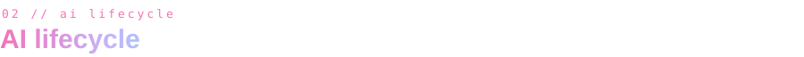

<p align="center">
  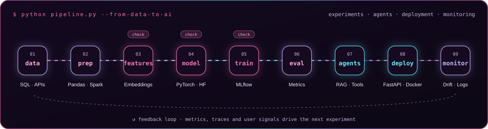
</p>


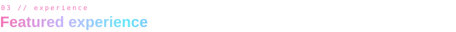

> **🔬 AI & NLP Research · CVE Event Extraction** · *2026 - present*  
> Research on extracting structured events and relations from vulnerability descriptions, using cybersecurity NLP, Transformers and graph learning.
> `Python` `NLP` `Transformers` `CVE` `Graph Learning`

> **🛡️ Data & AI Internship · DEFENDR.GG** · *2026*  
> Worked on data and AI experimentation around reinforcement-learning personalization and analytics workflows, without exposing private datasets or internal architecture.
> `Python` `RL` `Data Engineering` `Analytics` `MLOps`

> **🤖 AI/ML Internship · VERMEG** · *2026*  
> Applied machine learning and AI engineering practices in a professional software environment.
> `Python` `Machine Learning` `AI Engineering`

> **⚙️ AI Automation & DevOps · Finlogik** · *2026*  
> Worked on automation and DevOps-oriented workflows with an AI engineering mindset.
> `Automation` `DevOps` `AI` `Engineering`


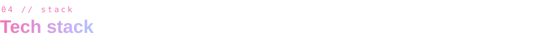

**🧠 AI & Machine Learning**
<p>
  
</p>

**💬 NLP, LLMs & Agents**
<p>
  
  
  
  
  
</p>

**🕸️ Reinforcement Learning & Graph Learning**
<p>
  
  
  
  
</p>

**🧱 Data Engineering**
<p>
  
  
  
  
</p>

**☁️ MLOps & Cloud**
<p>
  
  
  
</p>


<p align="center">
  
  <a href="https://github.com/Nour-Ghribi/car-diagnostic"></a>
</p>
<p align="center">
  <a href="https://github.com/Nour-Ghribi/Defendr-rl-personalization"></a>
  <a href="https://github.com/Nour-Ghribi/federated-autoencoder-fraud-detection"></a>
</p>
<p align="center">
  <a href="https://github.com/Nour-Ghribi/E-commerce-big-data-pipeline-master"></a>
  <a href="https://github.com/Nour-Ghribi/assurpilot-ai"></a>
</p>
<p align="center">
  <a href="https://github.com/Nour-Ghribi/rh-preselection-chatbot"></a>
  <a href="https://github.com/Nour-Ghribi/cybersecurity-ml-ddos-detection"></a>
</p>

<details>
<summary><b>✨ More public repositories</b></summary>
<br/>

| Project | What it is | Stack |
|:--|:--|:--|
| [Social Event Anomaly Detection](https://github.com/Nour-Ghribi/social-event-anomaly-detection-master) | Public anomaly detection project | Python |
| [SmartTender AI](https://github.com/Nour-Ghribi/SmartTender_AI) | AI-oriented tender assistance project | Python |
| [SMA E-commerce](https://github.com/Nour-Ghribi/Syst-me-Multi-Agents-SMA-E-commerce) | Multi-agent system for e-commerce | Python |
| [SignModel](https://github.com/Nour-Ghribi/SignModel) | Sign-language model project | Python |
| [D3 Climate Visualization](https://github.com/Nour-Ghribi/d3-climate-visualization) | Data visualization project | HTML / D3 |

</details>


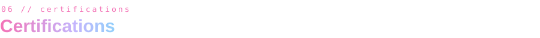

<p>
  
  
  
</p>


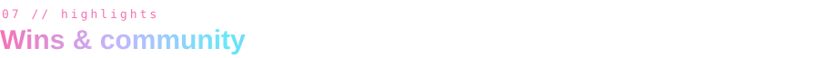

| 🏆 Awards | 🤝 Leadership & community |
|:--|:--|
| 🥇 **First Place** · AI Night Challenge | 👩‍🏫 **RL Instructor** · ATIA Club |
| 🥇 **First Place** · D-Clickathon | 👩‍🏫 **MLOps Instructor** · IEEE CS FST |
| | 🚀 **Co-Founder** · HandiTalk |


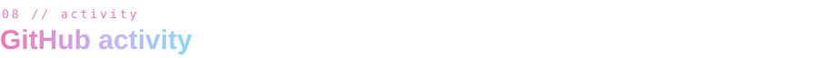

<p align="center">
  
  
</p>

<p align="center">
  
</p>

<p align="center">
  
</p>

<!-- Snake: generated by .github/workflows/snake.yml on the "output" branch -->
<p align="center">
  
</p>


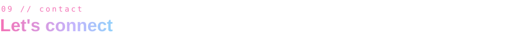

<p align="center">
  <a href="https://github.com/Nour-Ghribi"></a>
  <a href="https://github.com/Nour-Ghribi?tab=repositories"></a>
  
</p>

<p align="center">
  
</p>
